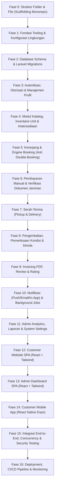

# Camera Rental Platform - Implementation Plan & Phased Task Roadmap

Dokumen ini merupakan rencana implementasi komprehensif berdasarkan analisis mendalam terhadap dokumen `PRD_Camera_Rental.md` v1.0. Rencana ini menetapkan arsitektur teknis, pembagian fase pengembangan, mitigasi risiko, serta daftar tugas terstruktur untuk seluruh ekosistem Camera Rental.

---

## 1. Analisis Ringkas PRD & Arsitektur Sistem

### 1.1 Visi & Komponen Produk
Camera Rental adalah platform terpusat (*greenfield*) untuk penyewaan kamera digital dan perlengkapan fotografi dengan **satu backend API dan satu database terpusat**, melayani tiga antarmuka:
1. **Customer Website (SPA):** React + TypeScript + Vite + Tailwind CSS + shadcn/ui.
2. **Admin Dashboard (SPA):** React + TypeScript + Vite + Tailwind CSS + shadcn/ui (aplikasi & domain terpisah untuk isolasi sesi/keamanan).
3. **Customer Mobile Application:** React Native + Expo (Android-first).
4. **Backend API:** Laravel 13, REST API `/api/v1`, Laravel Sanctum, Eloquent ORM.
5. **Database & Storage:** Supabase PostgreSQL (dengan ekstensi `btree_gist` untuk exclusion constraints) & Supabase Storage (bucket publik untuk katalog, bucket privat untuk dokumen & bukti bayar).

### 1.2 Pilar Teknis Kritis (*Non-Negotiable Architecture*)
* **Anti Double-Booking (Defense in Depth):**
  1. *Application Validation:* Pra-cek ketersediaan per unit aktif (`operational_status = 'active'`).
  2. *Database Transaction & Concurrency Lock:* `SELECT ... FOR UPDATE` pada baris `camera_units` kandidat berurutan ID.
  3. *Exclusion Constraint PostgreSQL:* `EXCLUDE USING gist (camera_unit_id WITH =, rental_period WITH &&) WHERE (released_at IS NULL)` pada tabel `booking_item_units`. Menjamin level kernel database bahwa tidak ada overlap tanggal sewa.
  4. *Idempotency-Key:* Header unik pada `POST /bookings` untuk mencegah duplikasi checkout akibat retry jaringan.
* **Perhitungan Durasi Inclusive (KB-04):**
  * `Total Hari = (Tanggal Selesai - Tanggal Mulai) + 1`.
  * Rentang PostgreSQL: `daterange(start_date, end_date, '[]')`.
* **Immutability & Snapshot Transaksi (DB-06):**
  * Perubahan master data (harga harian, nama produk, alamat, rekening) **tidak boleh** mengubah transaksi lampau.
  * Snapshot harga, nama, alamat, nomor rekening disimpan di `booking_items`, `bookings`, `payments`, dan `invoices`.
* **Pemisahan Autentikasi & Sesi (Solusi Konflik K-01):**
  * Customer Web & Admin Dashboard menggunakan cookie sesi Sanctum SPA. Untuk mencegah tabrakan cookie sesi pada browser yang sama, Admin Dashboard dijalankan pada subdomain/domain terpisah (misal `admin.camerarental.local`) dengan konfigurasi cookie session terisolasi (`session.cookie = 'admin_session'`).
  * Android Mobile menggunakan personal access token Sanctum (`Authorization: Bearer <token>`) yang disimpan di `Expo SecureStore`.
* **Keamanan Dokumen Pribadi (UU PDP & TP-05):**
  * KTP, SIM, dan bukti transfer disimpan di bucket privat Supabase Storage.
  * Tidak ada URL publik langsung; akses hanya via signed URL berumur pendek (maks 5 menit) yang dihasilkan oleh backend Laravel, dan setiap akses admin dicatat dalam `audit_logs`.

---

## 2. Analisis Konflik PRD & Rekomendasi Solusi

| ID Temuan | Masalah di PRD | Rekomendasi Solusi Implementasi |
|---|---|---|
| **K-01** | Potensi tabrakan cookie sesi Sanctum antara Web Customer & Admin | Pisahkan origin frontend: `web.` dan `admin.`. Bedakan konfigurasi nama cookie sesi Laravel atau pisahkan guard admin. |
| **K-02** | Fitur ulasan & info serah-terima belum eksplisit di modul Android | Implementasikan `FR-AND-23` (ulasan) & `FR-AND-24` (info serah-terima) demi paritas fitur dengan web. |
| **K-03** | Status pengembalian (*returns*) belum terstandardisasi | Gunakan enum: `pending` (menunggu fisik), `inspecting` (pemeriksaan fisik/kondisi), `completed` (pemeriksaan tuntas). |
| **K-04** | Status pembayaran `refunded` belum memiliki aturan detail | Sediakan field pencatatan refund (`refund_amount`, `refund_note`, `refunded_at`) namun aksi refund dibatasi hanya oleh aksi manual admin setelah persetujuan tertulis. |
| **K-05** | Status booking untuk pembatalan operasional (kamera rusak pra-sewa) | Gunakan status `cancelled` dengan wajib mengisi `cancel_reason` dan `cancelled_by` (audit log). |
| **K-06** | Tabel awal PRD kurang untuk operasional lengkap | Tambahkan tabel terencana: `fulfillments`, `carts`, `cart_items`, `camera_specifications`, `unit_maintenances`, `settings`, `audit_logs`, `device_tokens`. |
| **K-07** | Pembayaran parsial/DP | Batasi 1 pembayaran lunas per booking untuk MVP sesuai `KB-01`. |
| **K-10** | Risiko penahanan unit (*hold stock*) saat `pending_payment` | Terapkan batas waktu kedaluwarsa ketat (default 24 jam atau H-1 sewa, diatur via `settings`) dan scheduler pembatalan otomatis per menit (`JOB-01`). |

---

## 3. Peta Jalan Pengembangan (Implementation Phases)

---

## 4. Daftar Rinci Tugas per Fase

### Fase 0: Struktur Folder & File (Scaffolding Monorepo) - *SEDANG DIKERJAKAN*
- [x] Inisialisasi struktur workspace `CameraRental` di `c:\Antigravity\Project\CameraRenrtal\CameraRental`.
- [x] Pembuatan direktori terpisah:
  - `backend/` (Laravel 13 API REST)
  - `frontend-customer/` (React Vite Tailwind SPA untuk Pelanggan)
  - `frontend-admin/` (React Vite Tailwind SPA untuk Admin Dashboard)
  - `mobile-customer/` (React Native Expo untuk Android)
  - `shared/` (Tipe TypeScript bersama, skema OpenAPI, DTO contracts)
  - `docs/` (Dokumentasi arsitektur, ERD, ADR, API specs)
- [x] Setup `.gitignore` monorepo komprehensif (PHP, Node, Expo, Environment secrets).
- [x] Dokumentasi README untuk root dan masing-masing sub-proyek.

### Fase 1: Fondasi Tooling & Konfigurasi Lingkungan
- [ ] Setup runtime PHP 8.3+ / Composer dan inisialisasi skeleton Laravel 13 di `backend/`.
- [ ] Setup Node.js workspace, Vite + React + TypeScript di `frontend-customer/` dan `frontend-admin/`.
- [ ] Inisialisasi proyek Expo di `mobile-customer/`.
- [ ] Setup file konfigurasi environment (`.env.example`) untuk masing-masing modul.
- [ ] Konfigurasi koneksi Supabase (PostgreSQL & Storage S3-compatible).
- [ ] Setup linter & formatter (Laravel Pint / PHPStan, ESLint, Prettier).

### Fase 2: Database Schema & Laravel Migrations
- [ ] Migrasi pengaktifan ekstensi PostgreSQL: `btree_gist`, `citext`, `uuid-ossp`.
- [ ] Migrasi tabel identitas & pengguna: `users`, `addresses`, `personal_access_tokens`, `sessions`.
- [ ] Migrasi tabel katalog & inventaris: `categories`, `cameras`, `camera_images`, `camera_specifications`, `camera_units`, `unit_maintenances`.
- [ ] Migrasi tabel booking & exclusion constraint:
  - `bookings` (dengan denormalisasi rentang & status)
  - `booking_items` (dengan generated column `total_days`)
  - `booking_item_units` (dengan `daterange` dan `EXCLUDE USING gist`)
  - `booking_status_histories`.
- [ ] Migrasi tabel verifikasi & keuangan:
  - `guarantee_document_types`, `booking_documents`
  - `payment_methods`, `payments`, `payment_proofs`
  - `invoices`, `penalties`.
- [ ] Migrasi tabel operasional & interaksi:
  - `fulfillments`, `returns`, `return_items`, `reviews`, `carts`, `cart_items`.
- [ ] Migrasi tabel sistem & pelacakan: `notifications`, `device_tokens`, `settings`, `audit_logs`, `jobs`, `failed_jobs`.
- [ ] Pembuatan Database Seeders untuk default role admin, kategori awal, jenis dokumen jaminan, metode pembayaran, dan default settings.

### Fase 3: Backend Authentication, Authorization & User Profile Core
- [ ] Setup Laravel Sanctum untuk SPA Session (Web Customer & Admin) dan Bearer Token (Mobile).
- [ ] Implementasi Form Requests & Controllers:
  - `API-AUTH-01` Register Pelanggan
  - `API-AUTH-02` Login Pelanggan (Web Cookie)
  - `API-AUTH-03` Login Android (Sanctum Token)
  - `API-AUTH-04` Logout & token revocation
  - `API-AUTH-05` Endpoint `/auth/me`
  - `API-AUTH-06..08` Forgot password, reset password & change password
  - `API-AUTH-11..13` Dedicated Admin Login, Logout & Me
- [ ] Implementasi Middleware `role:admin` dan `role:customer`.
- [ ] CRUD Alamat Pelanggan (`API-ADR-01..06`) dengan jaminan 1 alamat utama aktif.
- [ ] Pengelolaan device token push notification (`API-PRF-03..04`).

### Fase 4: Modul Katalog, Inventaris & Ketersediaan
- [ ] Public Catalog API: `GET /cameras`, detail kamera dengan slug, filter kategori/merek/harga/tanggal (`API-CAT-01..04`, `API-CTG-01..03`).
- [ ] Engine Pemeriksaan Ketersediaan (`API-AVL-01..03`):
  - Perhitungan ketersediaan berbasis `camera_units` berstatus `active`.
  - Memfilter unit yang sedang dialokasikan (`booking_item_units` dengan `released_at IS NULL` dan overlap tanggal) atau dalam perawatan (`unit_maintenances`).
- [ ] Admin Inventory API (`API-AIV-01..20`):
  - CRUD Kategori
  - CRUD Kamera, upload multi-gambar, manajemen spesifikasi
  - CRUD Unit Fisik (`unit_code`), riwayat unit, penjadwalan perawatan.

### Fase 5: Keranjang & Engine Booking (Anti Double-Booking)
- [ ] API Keranjang tersimpan di server (`API-CRT-01..05`).
- [ ] Endpoint Preview Perhitungan Harga (`API-BKG-01`).
- [ ] **Core Transactional Checkout (`API-BKG-02`):**
  - Implementasi validasi input & verifikasi `Idempotency-Key`.
  - Mulai Database Transaction (`DB::transaction`).
  - `SELECT FOR UPDATE` unit kandidat dengan sorting stabil untuk mencegah deadlock.
  - Rollback & HTTP 409 bila stok kurang atau terjadi bentrok.
  - Snapshot harga, nama produk, nomor unit, identitas pelanggan, alamat.
  - Insert atomik ke `bookings`, `booking_items`, `booking_item_units`, `payments`, `booking_status_histories`.
  - Catch Postgres error `23P01` (exclusion violation) sebagai safety net.
- [ ] Detail booking & riwayat transaksi pelanggan (`API-BKG-03..05`).
- [ ] Pembatalan booking oleh pelanggan (`API-BKG-06`).

### Fase 6: Pembayaran Manual & Verifikasi Dokumen Jaminan
- [ ] Integrasi Supabase Storage Private Bucket untuk dokumen dan bukti transfer.
- [ ] Layanan upload dokumen jaminan pelanggan (`API-DOC-01..04`) dengan sanitasi MIME dan SHA-256 hash.
- [ ] Layanan upload bukti pembayaran (`API-PAY-01..04`).
- [ ] Endpoint signed URL berumur pendek untuk akses berkas privat.
- [ ] Admin Document Verification workflow (`API-ABK-10..13`):
  - Review dokumen, terima/tolak dengan alasan wajib.
- [ ] Admin Payment Verification workflow (`API-APY-05..10`):
  - Review bukti transfer, pencocokan nominal.
  - Auto-transisi status booking ke `confirmed` jika pembayaran `verified` dan seluruh dokumen wajib `verified`.

### Fase 7: Serah-Terima (Pickup & Delivery)
- [ ] Manajemen Fulfillment (`API-BKG-07`, `API-ABK-05..06`):
  - Penjadwalan serah-terima (ambil sendiri vs antar kurir).
  - Penugasan kurir dan pencatatan biaya pengantaran snapshot.
- [ ] Operasional Handover (`API-ABK-05`):
  - Pencatatan kondisi fisik awal unit.
  - Opsi tukar unit pengganti sejenis sebelum serah-terima (`API-ABK-04`).
  - Transisi booking dari `confirmed` ke `ongoing`.

### Fase 8: Pengembalian, Pemeriksaan Kondisi & Denda
- [ ] Alur Pengembalian Barang (`API-RTN-01..02`, `API-ARN-01..03`):
  - Penerimaan unit kembali per item booking.
  - Transisi status pengembalian (`pending` -> `inspecting`).
- [ ] Pemeriksaan Kondisi Unit (`API-ARN-04..06`):
  - Checklist inspeksi fisik (kondisi: `good`, `damaged`, `lost`).
  - Perhitungan otomatis keterlambatan (`late_days`).
  - Pembaruan otomatis status operasional unit jika rusak/hilang.
- [ ] Manajemen Denda (`API-ARN-07..11`):
  - Pencatatan denda terlambat, kerusakan, atau kehilangan.
  - Transisi denda (`unpaid`, `paid`, `waived`).
  - Pelepasan alokasi unit (`released_at = now()`) dan transisi booking ke `completed` setelah seluruh unit selesai diperiksa.

### Fase 9: Invoicing PDF, Review & Rating
- [ ] Invoicing Engine (`API-INV-01..03`, `API-APY-11..14`):
  - Penomoran invoice sekuensial unik (`INV/YYYY/MM/XXXX`).
  - Snapshot detail tagihan sewa dan denda.
  - Background Job generate PDF invoice.
- [ ] Modul Ulasan Pelanggan (`API-REV-01..03`, `API-ARN-12..13`):
  - Ulasan rating 1-5 bintang & komentar per item booking selesai.
  - Moderasi visibilitas ulasan oleh admin.

### Fase 10: Notifikasi (Push/Email/In-App) & Background Jobs
- [ ] In-App Notification System berbasis tabel `notifications` (`API-NTF-01..04`).
- [ ] Integrasi Resend / SMTP untuk email transaksional:
  - Template email: Booking Baru, Pembayaran Diterima/Ditolak, Dokumen Ditolak, Booking Confirmed, Invoice.
- [ ] Integrasi Expo Push Notification service untuk Android.
- [ ] Implementasi Scheduler Jobs (Cron):
  - `JOB-01`: Auto-expire booking `pending_payment` yang lewat `expires_at` (menit).
  - `JOB-02`: Pengingat batas waktu pembayaran (15 menit).
  - `JOB-03`: Pengingat jadwal serah-terima H-1 dan Hari H.
  - `JOB-04`: Pengingat batas pengembalian dan deteksi keterlambatan.
  - `JOB-05`: Pembersihan token usang dan file kedaluwarsa.

### Fase 11: Admin Analytics, Laporan & System Settings
- [ ] Dashboard KPI metrics & chart aggregation (`API-ADS-01..03`).
- [ ] Laporan Transaksi, Pendapatan, Utilisasi Unit, dan Denda (`API-RPT-01..08`) dengan ekspor CSV/XLSX.
- [ ] Pengaturan Sistem dinamis (`API-SET-01..02`): batas jam bayar, toleransi denda, informasi toko, jam operasional.
- [ ] Health check endpoint (`API-SET-03`).

### Fase 12: Customer Website SPA (React + Tailwind)
- [ ] Setup UI layout, routing, dan React Query provider.
- [ ] Halaman Publik: Landing page, Katalog, Pencarian & Filter, Detail Kamera, Kalender Ketersediaan.
- [ ] Halaman Autentikasi: Login, Register, Lupa Password, Reset Password.
- [ ] Halaman Transaksi: Keranjang, Multi-step Checkout, Halaman Instruksi Pembayaran & Upload Bukti, Upload Dokumen Jaminan.
- [ ] Halaman Pelanggan: Dashboard Akun, Riwayat Booking, Detail Booking & Timeline Status, Unduh Invoice, Profil & Alamat.

### Fase 13: Admin Dashboard SPA (React + Tailwind)
- [ ] Setup Dashboard layout, navigation sidebar, dan authentication guard.
- [ ] Antrian Kerja Cepat (*Action Required Task Queue*): Bukti bayar pending, Dokumen pending, Jadwal pickup/antar hari ini, Pengembalian hari ini.
- [ ] Manajemen Katalog & Unit: Kategori, Kamera, Galeri Foto, Unit Fisik, Jadwal Perawatan.
- [ ] Manajemen Transaksi & Verifikasi: Verifikasi Pembayaran (preview bukti + zoom), Verifikasi Dokumen, Detail Booking lengkap, Pembatalan/Tukar Unit.
- [ ] Operasional Serah-Terima & Pengembalian: Check-in pengembalian, Formulir inspeksi kondisi fisik, Penerbitan denda.
- [ ] Laporan & Pengaturan: Chart interaktif, Filter ekspor laporan, Form pengaturan sistem.

### Fase 14: Customer Mobile App (React Native Expo)
- [ ] Setup navigasi Expo Router / React Navigation (Bottom Tabs + Stack).
- [ ] Integrasi Expo SecureStore untuk Sanctum Bearer Token.
- [ ] Layar: Splash, Autentikasi, Katalog Kamera, Filter & Search, Detail Kamera, Keranjang, Checkout native flow.
- [ ] Kompresi gambar kamera/galeri & upload bukti bayar serta dokumen jaminan.
- [ ] Registrasi Expo Push Token & penanganan deep link ke detail booking dari push notification.
- [ ] Riwayat booking, timeline status real-time, dan tampilan invoice.

### Fase 15: Integrasi End-to-End, Concurrency & Security Testing
- [ ] Uji Konkurensi Anti Double-Booking (k6 / script paralel 100+ concurrent requests pada unit sama -> tepat 1 booking berhasil, sisanya 409).
- [ ] Uji Otorisasi & Pencegahan IDOR (Customer A tidak boleh membaca/mengubah booking Customer B).
- [ ] Uji Rate Limiting (Brute-force protection pada login & reset password).
- [ ] Uji Transaksi Failure & Database Rollback (Simulasi error di tengah checkout -> 0 data parsial tersisa).
- [ ] Uji Alur Lengkap: Guest -> Register -> Booking Multi-item -> Upload Dokumen & Bukti -> Verifikasi Admin -> Serah-terima -> Pengembalian & Denda -> Selesai -> Ulasan.

### Fase 16: Deployment, CI/CD Pipeline & Monitoring Setup
- [ ] Setup GitHub Actions CI: linting, type-checking, PHPUnit test run, build test.
- [ ] Konfigurasi hosting: Cloudflare Pages / Vercel (Customer Web & Admin Dashboard), Docker container (Laravel API di Cloud VPS/PaaS).
- [ ] Konfigurasi Production Supabase (Database pooler mode, Storage buckets).
- [ ] Setup Worker Queue runner & Systemd Cron Scheduler di server backend.
- [ ] Integrasi Sentry error tracking & logging terpusat.
- [ ] Build & distribusi testing APK Android via Expo EAS.
