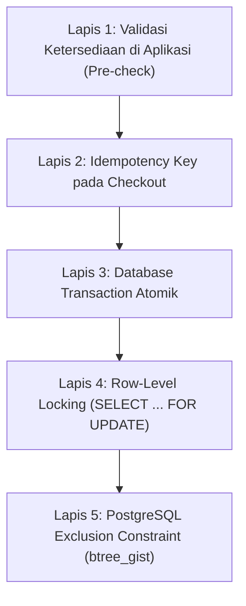

# Double Booking Prevention Strategy

## 1. Konsep Multi-Layer Defense (Defense in Depth)

Sistem penyewaan kamera mengandalkan inventaris per unit fisik berkode unik (`camera_units.unit_code`). Mencegah bentrok jadwal adalah prioritas absolut (**GOAL-01: 0 kasus**).

Strategi yang diterapkan mencakup 5 lapis proteksi:



## 2. Definisi Exclusion Constraint

Pada tabel `booking_item_units`, constraint exclusion PostgreSQL memastikan tidak ada dua alokasi aktif yang beririsan untuk unit yang sama:

```sql
CREATE EXTENSION IF NOT EXISTS btree_gist;

ALTER TABLE booking_item_units
  ADD CONSTRAINT booking_item_units_no_overlap
  EXCLUDE USING gist (
    camera_unit_id WITH =,
    rental_period  WITH &&
  ) WHERE (released_at IS NULL);
```

### Durasi Inclusive
Karena durasi sewa bersifat inklusif (`Total Hari = Selesai - Mulai + 1`), `rental_period` dibentuk menggunakan rentang tertutup `[]`:
```sql
rental_period daterange GENERATED ALWAYS AS (daterange(start_date, end_date, '[]')) STORED
```
Dengan demikian, bila Unit A disewa 10 Des - 12 Des dan ada permintaan sewa lain pada 12 Des - 14 Des, PostgreSQL secara otomatis menolak permintaan kedua dengan error code `23P01`.
